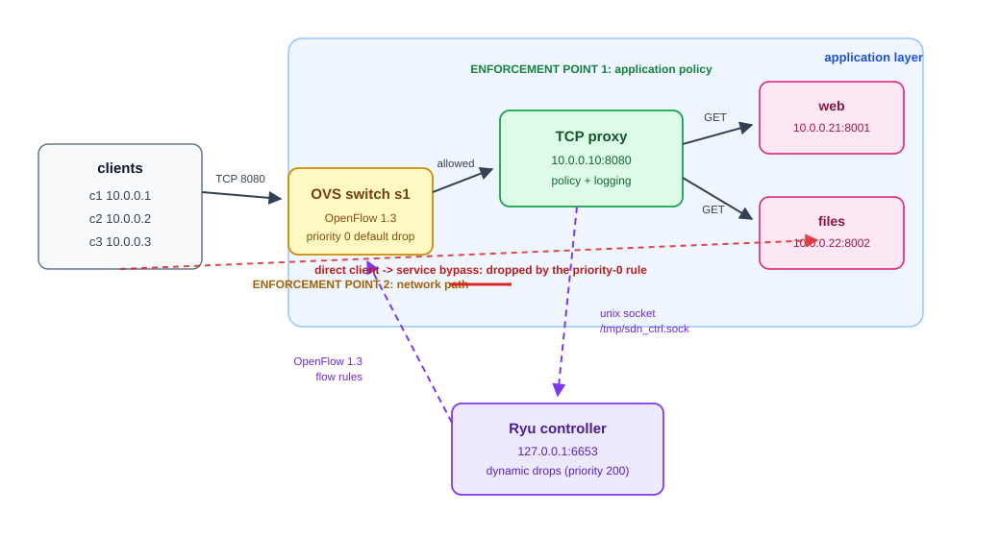
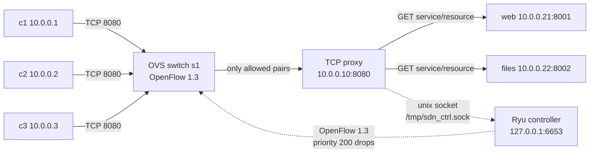

# Architecture

## Two layers, two jobs

The proxy and the controller are independent enforcement points:

| Layer | Enforces | Cannot do alone |
|---|---|---|
| Proxy (application) | `GET service/resource` policy, keyword matching, per-client rules, logging, automatic abuse blocks | Stop a client that connects straight to a service port |
| Switch + controller (network) | Only client→proxy and proxy→service paths; drop rules for blocked services/clients; automatic drop for a flooding client | Read application requests or match keywords |

Neither layer is sufficient on its own:

* Without the switch, `c1 -> 10.0.0.21:8001` bypasses the proxy completely.
  The controller's default drop rule makes the proxy the only path.
* Without the proxy, the switch sees only IP addresses and ports. It cannot
  distinguish `GET web/index` from `GET web/secret-plan`, and it cannot produce a
  per-request permit/block log.

The two layers are kept consistent from one config file
(`config/network.json`) and one policy file (`config/policy.json`).

## Request path

1. Client opens TCP to `10.0.0.10:8080`.
2. Switch matches `nw_src=client, nw_dst=10.0.0.10` (priority 100) and forwards.
3. Proxy reads one line, parses `GET <service>/<resource>`.
4. Policy decides (`deny` -> `BLOCKED <reason>`, log and close).
5. If allowed, proxy opens a connection to the service, sends `GET /<resource>`,
   relays bytes back, and logs `permit`.
6. If the service is down, the proxy answers `ERROR service unavailable`.
7. A direct client→service packet has no matching priority-100 pair and hits the
   priority-0 drop rule, so a bypass attempt times out.

## Controller flow table

| Priority | Match | Action | Purpose |
|---|---|---|---|
| 200 | `ip, nw_src, nw_dst` | drop | dynamic policy/auto-block drop |
| 100 | `arp` | NORMAL | MAC discovery |
| 100 | allowed client↔proxy pair | NORMAL | application path |
| 100 | allowed proxy↔service pair | NORMAL | application path |
| 0 | any | drop | default deny |

The allowed pairs are generated from `config/network.json`, so adding a client
or service to the config also updates the switch rules.

## Policy changes and failures

* **Manual change**: `ctl.py BLOCK web` -> proxy updates the first-match rule
  table, saves `config/policy.json`, computes the new drop set, and sends
  `DROP 10.0.0.10 10.0.0.21` to the controller (priority 200).
* **Switch reconnect**: `EventOFPSwitchFeatures` re-installs both the default
  rules and every entry in the controller's `dynamic_drops` set.
* **Controller restart**: the proxy pings the controller. The reply carries a
  boot id; a new id means the controller lost its table, so the proxy clears its
  "already synced" set and re-pushes the whole desired set. The proxy also
  retries unsynced rules on a timer.
* **Proxy restart**: the proxy starts with an empty synced set and sends
  `CLEAR`, then re-pushes the policy, preventing stale drop rules. Request
  counters are loaded from `logs/stats.json`.
* **Flood**: the proxy counts malformed requests and request rate per source
  IP. Crossing a threshold installs a temporary deny entry and a priority-200
  client→proxy drop, so the attack is stopped before it reaches the proxy. The
  entry expires after `block_seconds` or on `UNBLOCK <ip>`.

## Precedence

`Policy.decide` checks, in order:

1. active automatic blocks (temporary, highest precedence),
2. saved rules top to bottom, first match wins,
3. `default`.

A rule matches when `client` is `*` or equals the source IP, `service` is `*` or
equals the requested service, and `keyword` is empty or appears in the resource.
